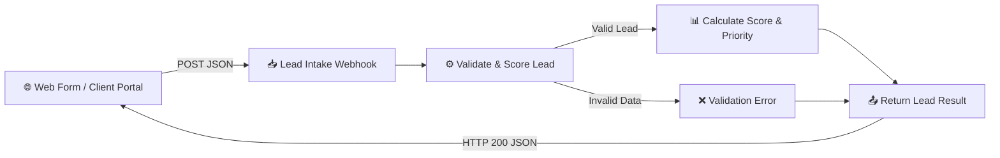

# 🚀 AI Lead Generation & CRM Automation (n8n)

An automated lead intake, qualification, and scoring pipeline built with **[n8n](https://n8n.io/)**. This workflow captures incoming leads via an HTTP webhook, validates contact information, calculates an explainable lead qualification score (0–100), assigns priority levels (`HOT`, `WARM`, `COLD`), and returns actionable recommendations instantly.

---

## 📌 Table of Contents

- [Overview](#-overview)
- [Architecture & Flow](#-architecture--flow)
- [Features](#-features)
- [Lead Scoring Matrix](#-lead-scoring-matrix)
- [API Reference](#-api-reference)
  - [Webhook Endpoint](#webhook-endpoint)
  - [Example Request](#example-request)
  - [Example Responses](#example-responses)
  - [Testing with cURL](#testing-with-curl)
- [Installation & Setup](#-installation--setup)
- [How It Works (Node Breakdown)](#-how-it-works-node-breakdown)
- [Future Enhancements & AI Integrations](#-future-enhancements--ai-integrations)
- [License](#-license)

---

## 🔍 Overview

Managing incoming leads manually leads to delayed response times and lost sales opportunities. This workflow acts as the front-line automation layer between your website/portfolio contact forms and your CRM or sales team:

1. **Captures** incoming submissions via a REST webhook.
2. **Validates** crucial contact information (`name`, valid `email`).
3. **Scores** the lead in real-time across budget, timeline urgency, company presence, and requirements depth.
4. **Categorizes** the lead into `HOT`, `WARM`, or `COLD` tiers.
5. **Returns** a structured JSON response with clear next-step recommendations for sales reps or automated follow-up systems.

---

## 🏗️ Architecture & Flow



---

## ✨ Features

- **⚡ Instant Webhook Ingestion:** Accepts JSON payloads from any frontend framework, landing page builder (Webflow, WordPress, Framer), or custom API.
- **🛡️ Input Validation & Sanitization:** Verifies required fields and email syntax before processing.
- **🎯 Transparent Scoring Engine:** Evaluates leads using deterministic, explainable weights without black-box confusion.
- **🏷️ Automated Prioritization:**
  - 🔥 **HOT (Score ≥ 70):** High-budget, urgent timeline. Recommended action: *Immediate discovery call.*
  - ⚡ **WARM (Score 40–69):** Qualified prospect with moderate requirements. Recommended action: *Personalized 24h follow-up.*
  - ❄️ **COLD (Score < 40):** Low budget or vague scope. Recommended action: *Nurture via email campaign.*
- **🧩 AI-Ready Architecture:** Designed to easily snap in Large Language Model (LLM) nodes for sentiment analysis, pitch draft generation, and lead enrichment.

---

## 📊 Lead Scoring Matrix

The workflow evaluates each lead across 4 key dimensions with a maximum score of **100 points**:

| Dimension | Criteria | Points Added |
| :--- | :--- | :--- |
| **Budget** | ≥ \$10,000 | **+35 pts** |
| | \$5,000 – \$9,999 | **+25 pts** |
| | > \$0 | **+10 pts** |
| **Timeline** | Immediate / within a week | **+30 pts** |
| | Within a month | **+20 pts** |
| | Any specified timeline | **+10 pts** |
| **Company** | Company name provided | **+15 pts** |
| **Project Scope** | Detailed description (≥ 80 characters) | **+20 pts** |
| | Basic description (≥ 20 characters) | **+10 pts** |

---

## 📡 API Reference

### Webhook Endpoint

- **Method:** `POST`
- **Path:** `/webhook/portfolio-lead-intake` *(production)* or `/webhook-test/portfolio-lead-intake` *(testing)*

### Example Request

```json
{
  "name": "Jane Doe",
  "email": "jane.doe@enterprise.com",
  "company": "Acme Innovations Ltd.",
  "budget": 12500,
  "timeline": "immediate",
  "message": "We need to automate our inbound lead generation workflow and integrate it into our HubSpot CRM within the next two weeks."
}
```

### Example Responses

#### ✅ High Priority Lead (`HOT`):
```json
{
  "success": true,
  "workflow": "AI Lead Generation & CRM",
  "lead": {
    "name": "Jane Doe",
    "email": "jane.doe@enterprise.com",
    "company": "Acme Innovations Ltd.",
    "message": "We need to automate our inbound lead generation workflow and integrate it into our HubSpot CRM within the next two weeks.",
    "budget": 12500,
    "timeline": "immediate"
  },
  "qualification": {
    "score": 100,
    "priority": "HOT",
    "reasons": [
      "Budget is 10,000 or above",
      "Urgent implementation timeline",
      "Company information provided",
      "Detailed business requirement provided"
    ]
  },
  "recommendedAction": "Contact immediately and schedule a discovery call.",
  "processedAt": "2026-11-17T23:00:00.000Z",
  "note": "This starter workflow uses explainable rule-based scoring. Connect an LLM node to add AI-generated summaries or enrichment."
}
```

#### ❌ Missing Required Fields:
```json
{
  "success": false,
  "workflow": "AI Lead Generation & CRM",
  "error": "A valid name and email are required.",
  "received": {
    "name": "",
    "email": "invalid-email"
  }
}
```

### Testing with cURL

```bash
curl -X POST "http://localhost:5678/webhook-test/portfolio-lead-intake" \
  -H "Content-Type: application/json" \
  -d '{
    "name": "Alex Smith",
    "email": "alex@techstart.io",
    "company": "TechStart Inc",
    "budget": 7500,
    "timeline": "within 2 weeks",
    "message": "Looking for automated CRM pipeline integrations and n8n consulting."
  }'
```

---

## ⚙️ Installation & Setup

### 1. Prerequisites
- An active instance of **[n8n](https://n8n.io/)** (Cloud, Docker, or Desktop).

### 2. Import Workflow into n8n
1. Open your n8n workspace.
2. In the top-right corner, click **Add Workflow** (`+`) or the **...** menu.
3. Select **Import from File**.
4. Choose [`AI_Lead_Generation_CRM.json`](./AI_Lead_Generation_CRM.json).

### 3. Activate the Webhook
1. Open the **Lead Intake Webhook** node.
2. Copy the **Production URL** (or **Test URL** for testing).
3. Toggle the workflow to **Active** in the top navigation bar.

---

## 🧩 How It Works (Node Breakdown)

| Node | Type | Function |
| :--- | :--- | :--- |
| **Lead Intake Webhook** | `n8n-nodes-base.webhook` | Receives incoming POST requests and captures the payload. Configured to respond using a downstream response node. |
| **Validate & Score Lead** | `n8n-nodes-base.code` | JavaScript node executing validation checks, calculating the score from budget/timeline/company/message data, and assigning priority tiers. |
| **Return Lead Result** | `n8n-nodes-base.respondToWebhook` | Returns the scored object and recommendations directly back to the HTTP client with status code `200`. |

---

## 🔮 Future Enhancements & AI Integrations

This starter template provides the solid foundation to expand into a fully autonomous sales agent:

- [ ] **AI Summaries & Enrichment:** Add an OpenAI, Anthropic, or Gemini node to analyze client websites and generate executive briefing summaries.
- [ ] **CRM Synchronization:** Push qualified leads automatically into HubSpot, Salesforce, Notion, or Airtable.
- [ ] **Instant Team Notifications:** Alert sales reps on Slack, Discord, or Microsoft Teams whenever a `HOT` lead arrives.
- [ ] **Automated Email Outreach:** Draft and dispatch personalized reply emails using Gmail or SendGrid based on lead priority.

---

## 📄 License

This project is open-source and available under the [MIT License](LICENSE).
