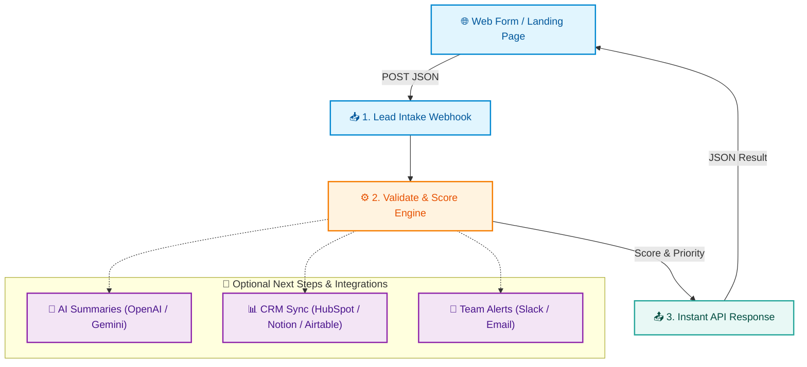

# 🚀 AI Lead Generation & CRM Automation

<p align="center">
  
  
  
  
</p>

A lightweight, high-performance **n8n automation** that instantly captures website leads, validates contact details, calculates an intelligent qualification score, and routes actionable insights to your sales pipeline.

---

## 🧭 System Flow & Architecture



---

## ⚡ How It Works in 3 Steps

| Step | Component | Description |
| :---: | :--- | :--- |
| **1** | **Ingest** | Captures incoming lead requests from any contact form via a secure webhook. |
| **2** | **Score** | Evaluates project budget, urgency, company name, and requirements to generate a **0–100 score**. |
| **3** | **Route** | Flags the lead as **`HOT`**, **`WARM`**, or **`COLD`** with immediate next-step guidance. |

---

## 🎯 Lead Priority Matrix

```
   Score Range        Priority          Recommended Action
 ┌──────────────┬──────────────────┬──────────────────────────────────────────┐
 │   70 – 100   │   🔥  HOT        │   Call immediately & book discovery call  │
 │   40 – 69    │   ⚡  WARM       │   Send personalized follow-up in 24 hrs   │
 │    0 – 39    │   ❄️  COLD       │   Enroll in long-term nurture sequence    │
 └──────────────┴──────────────────┴──────────────────────────────────────────┘
```

---

## 🔌 APIs & Integrations Required

### 1. Inbound Webhook (Core)
- **Method:** `POST`
- **Path:** `/webhook/portfolio-lead-intake`
- **Payload Schema:**
  ```json
  {
    "name": "Jane Doe",
    "email": "jane@example.com",
    "company": "Acme Corp",
    "budget": 10000,
    "timeline": "immediate",
    "message": "Looking for n8n CRM automation."
  }
  ```

### 2. Connected & Extensible APIs

| Service | Category | Purpose | Status |
| :--- | :--- | :--- | :--- |
| **Webhook API** | Core | Ingests lead submissions from web forms | `Included` |
| **OpenAI / Gemini API** | AI & LLM | Generates executive summaries & pitch drafts | `Ready to connect` |
| **HubSpot / Airtable API** | CRM | Auto-creates contacts, deals, and notes | `Ready to connect` |
| **Slack / Resend API** | Notifications | Real-time alerts for high-value `HOT` leads | `Ready to connect` |

---

## 🚀 Quick Start

1. **Import:** In your n8n workspace, click **Add Workflow** > **Import from File** and select [`AI_Lead_Generation_CRM.json`](./AI_Lead_Generation_CRM.json).
2. **Activate:** Open the **Lead Intake Webhook** node and switch the workflow toggle to **Active**.
3. **Connect:** Point your website form's `POST` request to the generated webhook URL.

---

## 📄 License

Distributed under the [MIT License](LICENSE).
